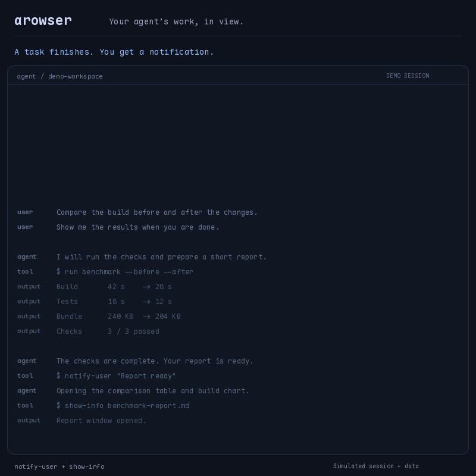

# arowser



**Agent-programmable web windows for macOS.** One command puts a URL in a small borderless window you can place anywhere — and the CLI is designed to be driven by coding agents: windows are addressed by stable ids, multiple agents can work simultaneously without stepping on each other, and login states survive restarts.

The name: **a**rowser is **b**rowser with the b swapped for **a** — *a* for *agent*: a browser whose primary user is your coding agent, opening windows for you to look at. It grew out of the author's own daily agent workflow — agents popping up dashboards, reports and notification cards during real work sessions — and it never touches your other browsers' settings or data.

## Why

Most agent-browser tooling is about the agent *using* a browser (scraping, automating). arowser is about the opposite direction: **the agent showing things to you** — a project board, a Grafana panel, a log page, a build result — while you keep working. It also works fine as a human tool for "keep this page in a corner of my screen".

- Agents pop scene-appropriate pages on demand; nothing to click through
- Each window has a unique id; navigation, hide, close act on that id only
- Multiple agents each get their own windows, with ownership checks to prevent accidental cross-agent interference
- Small windows stay readable: pages auto-scale to the window width, or switch to a mobile user agent

## Install

Requires macOS 12+. Two ways:

### Homebrew (tap)

```bash
brew tap HankMonster/arowser
brew install --cask HankMonster/arowser/arowser
```

On newer Homebrew versions that refuse third-party taps, run `brew trust hankmonster/arowser` between the two commands.

Installs the app to `/Applications` and links `arowser` / `arowser-watch` into Homebrew's bin.

### From source

Requires Swift (Xcode Command Line Tools). No other dependencies.

```bash
git clone https://github.com/HankMonster/arowser.git
cd arowser
./build.sh
```

`build.sh` compiles the single-file Swift app and installs:

- App: `~/Applications/arowser.app` (bundle id `com.hank.arowser`)
- CLI: `~/.local/bin/arowser` (make sure `~/.local/bin` is on your PATH)
- Watcher: `~/.local/bin/arowser-watch`

The CLI finds the app at `$ARROWSER_APP`, then `~/Applications/arowser.app`, then `/Applications/arowser.app` — so Homebrew- and source-installed apps are both supported.

Rebuilding: quit the running instance first (`arowser quit --all`), or the old instance keeps holding the `arowser://` URL scheme.

## Quickstart

```bash
id=$(arowser open https://example.com --title demo)   # prints a unique window id
arowser show "$id" https://example.org                # navigate just this window
arowser show "$id"                                    # bring to front / unhide, no reload
arowser close "$id"

# small window, mobile-first site
arowser open https://www.baidu.com --title Baidu --mobile --w 460 --h 620
```

Windows have no title bar and no traffic lights: drag the 28pt strip along the top (or ⌥-drag anywhere), resize from the edges, close with ⌘W when focused (or `arowser close <id>`).

## CLI reference

```
arowser open <url> [--id ID] [--owner NAME] [--title T]
                   [--x N] [--y N] [--w N] [--h N] [--center]
                   [--private | --profile NAME]
                   [--no-fit | --fit] [--mobile | --no-mobile] [--float | --no-float] [--force]
arowser show <id> [url] [same options as open]
arowser hide <id>   [--owner NAME] [--force]
arowser close <id>  [--owner NAME] [--force]
arowser reload <id> [--owner NAME] [--force]
arowser serve <dir> [--id NAME]            # mount dir, prints its URL
arowser open <dir> --serve [open options]  # mount + open in one step
arowser list [--owner NAME] [--json]
arowser quit --all
arowser restore                           # reopen last session / dead records
```

Exit codes: `0` success (stdout prints the window id), `3` rejected (no such window, owner mismatch, profile conflict), `4` no response (app not running/registered).

The control plane is the `arowser://` URL scheme plus per-request ack files — no listening port, no Accessibility permission. Any local process can invoke the scheme; ownership is an anti-mistake guard, not a security boundary.

## Features

### Windows and display

- **Placement**: `--w/--h/--x/--y` size and position (top-left origin, same coordinates as screenshots; secondary displays may be negative). Omitted axes default to the top-right of the main screen's visible area, staggered per window; placement is remembered per id. `--center` centers on the main screen and wins over `--x/--y`.
- **Fit to width** (`--fit`, default): pages wider than the window at 100% zoom are scaled down proportionally (floor 0.3) so the full layout is visible; responsive pages stay at 1.0. `--no-fit` keeps 100%.
- **Mobile UA** (`--mobile`): iPhone user agent for mobile-first sites that read better in narrow windows. The default UA is desktop Safari — the bare WKWebView UA makes some sites serve blank anti-bot pages.
- **Floating** (`--float`/`--no-float`): windows default to normal level since 2026-11-13; `--float` pins a window above other apps (per-window, persisted, also in the context menu). Reserve it for things that must stay visible, e.g. notification cards.
- **Zoom** (focused): `⌘+`/`⌘-` (×1.2 steps, 0.2–3.0), `⌘0` back to 100%, `⌘9` re-enable fit. Manual zoom overrides `--fit` until `⌘9`.
- **Find** (focused): `⌘F` opens a find bar with live highlighting; `Return`/`Shift+Return` step, `Esc` closes. `⌘G`/`⇧⌘G` step without the input. Main frame only; highlights up to 2000 matches.
- **Context menu**: Copy Link / Open in Default Browser / Back / Forward / Reload / Windows ▸ / Unfloat|Float on Top / Disable|Enable Drag Bar / Hide (⌘H) / Close (⌘W — acts on the window under the cursor). Disable Drag Bar frees the top 28pt for page clicks; move with ⌥-drag while disabled.
- **Popups**: `target=_blank`/`window.open` navigate the current window by default; ⌘-click opens a new arowser window (inherits owner/profile/UA/fit, honors `windowFeatures`).
- **Error cards**: unreachable URLs render a native dark error card (reason, domain/code, Retry button) instead of a white screen; `arowser list --json` exposes a per-window `error` field so agents can detect dead links programmatically.

### Multi-agent isolation

- **Owner checks**: every window records its owner; id-addressed commands from another owner are rejected (exit 3) unless `--force`. Resolution order: `--owner` → `$AROWSER_OWNER` → `$CLAUDE_CODE_SESSION_ID` (prefixed `cc-`) → `anonymous`. Claude Code sessions get isolation for free; other agents should `export AROWSER_OWNER=<stable-id>`.
- **Cookie jars**: default jar is shared and persistent; `--private` is an ephemeral per-window jar; `--profile NAME` is a persistent per-profile jar (one account per profile). The jar binds at window creation — `show` with a different profile is rejected; switch by opening a new window.
- **Cookie mirror**: WebKit only persists cookies that carry an expiry, so session-cookie logins (the common SSO pattern) die with the app. arowser mirrors all jars to `~/Library/Application Support/arowser/cookie-mirror/` on window close/exit and reinjects on jar creation — logins survive cold restarts in every jar (except `--private`). A force-kill loses the last stretch of changes.
- **Quit safety**: `quit` requires `--all` so no agent accidentally clears every window; ⌘Q (human keyboard exit) confirms first, listing what will close.

### Local HTML and the built-in server

- Local files and directories (directory = its `index.html`) open via `file://` with read access granted to the HTML's directory; relative CSS/JS/images load fine.
- WebKit treats `file://` as an opaque origin — in-page `fetch`/XHR is blocked. For data-driven pages, mount the directory on the built-in static server:

```bash
url=$(arowser serve /path/to/dir)      # → http://127.0.0.1:<port>/<id>/
arowser open "$url" --title demo
arowser open /path/to/dir --serve      # one step
```

- Mounts persist in `serve.json`: same directory → same URL across restarts; the listener comes up at launch when mounts exist. Port conflicts rebind and rewrite (use relative URLs in pages to stay immune).
- Security boundary: 127.0.0.1 only, only explicitly served directories, Host-header allowlist (DNS rebinding), `..`/symlink escape blocking, no directory listing, `Cache-Control: no-store`. **No auth on localhost** — any local process can read a mounted directory; don't serve secrets.

### Live-reload preview

`arowser-watch` opens a local HTML file or directory and reloads the window on change — no third-party watcher dependency:

```bash
arowser-watch ./report.html --title Report
arowser-watch ./dashboard --deep            # recurse (skips .git/node_modules)
arowser-watch ./report.html --file-only     # watch the HTML itself only
```

Polls mtime+size (default 0.5s, `--interval`), settles before reload (`--settle` 0.25s) so one save = one reload; forwards other options to `arowser open`. Ctrl-C keeps the window (`--close-on-exit` closes it); the watcher exits when its window closes.

### Sessions, history, hotkeys

- **Session restore**: a confirmed ⌘Q snapshots all windows (ids, URLs, geometry, visibility, owner, profile, zoom); the next launch revives them after 1.2s. An agent cold-start `open`/`show` cancels the snapshot — one window in, one window out. `arowser restore` recovers from the snapshot or crash leftovers. `{"sessionRestore": false}` disables.
- **Window history**: `⌃⌥⌘K` (global) lists recently closed windows; selecting reopens on the **original id** with geometry/owner/profile — ids saved in an agent session keep working after close. Retention: 24h default (`historyHours`), 200 entries max; `--private` windows are never recorded.
- **Window picker**: `⌃⌥⌘L` (global, from any app, no Accessibility permission) with three-way semantics — hidden → show, visible-but-unfocused → front, focused → hide. Also in the context menu as `Windows ▸`.
- **Configurable hotkeys**: `~/Library/Application Support/arowser/settings.json` — `hotkey`, `historyHotkey` (e.g. `"ctrl+opt+cmd+J"`).
- **Resident process** (keepAlive): the app stays alive after the last window closes, so global hotkeys and history keep working; ⌘Q/`quit --all` exit for real. Old behavior: `{"keepAlive": false}`.
- **Menu bar item & Dock**: arowser is a regular app (Dock icon, ⌘Tab) with a menu bar status item (Windows ▸ / History ▸ / Quit; `{"statusItem": false}` disables). Launching a running instance activates it — zero windows opens the history picker, all-hidden opens the window picker, visible windows just activate.

## Agent integrations

Three ready-made agent skills ship in [`skills/`](skills/) — copy a skill directory into your agent's skill folder to install:

- [`skills/arowser`](skills/arowser/SKILL.md) — the complete usage manual as an agent skill (commands, serve, isolation, login states, boundaries)
- [`skills/notify-user`](skills/notify-user/SKILL.md) — task-done / needs-your-help notification cards in a shared pinned window, with a provenance line (project · session · time)
- [`skills/show-info`](skills/show-info/SKILL.md) — render results (GFM tables, charts via ECharts, long output) into a presentation window; includes a tested `md2window.py` pipeline

## How it's tested

Behavior changes are verified against the real app, not just compiled. Methods used across the feature set:

- **Window-level assertions** via `CGWindowList` (layer, geometry) rather than trusting status strings
- **Cookie persistence** verified with controlled repros (a login response mixing persistent and session cookies) and on-disk mirror inspection
- **CLI round-trips**: open → list --json → show/hide/close with exit-code checks; owner mismatch verified to exit 3
- **Honest boundaries**: macOS menus swallow synthetic events, so menu-item clicks are verified by humans; the README records which items are machine-verified vs human-verified
- show-info's render pipeline carries a unittest suite (`python3 -m unittest discover -s skills/show-info/tests`)
- Localization key coverage and `.strings` parsing: `python3 -m unittest discover -s tests` (uses macOS `plutil`).
- Localization was checked in the rebuilt app with `-AppleLanguages '(en)'` and `'(zh_CN)'`: native error-card text, find placeholder and no-results text were screenshot-verified; find-button tooltips and bar bounds were checked in the page. Menus and the ⌘Q dialog were human-verified in both languages (2026-11-13: English via an English-first system launch, Simplified Chinese via forced `zh_CN`). System-provided WebKit error descriptions remain English in both languages.

## Localization

The UI follows the system language: English is the default and Simplified Chinese is included; to add a language, contribute a `<language>.lproj/Localizable.strings` table with English-literal keys and add it to `build.sh`'s resource copy step.

## Limitations

- Rendering engine is system WebKit (WKWebView), not Chromium; Chrome-only sites may misbehave
- macOS 12+ only; notarized releases and Homebrew packaging are not yet available (build from source)
- No `unmount` for serve mounts and no `clear` for cookie jars yet — delete `serve.json` / the WebKit data directory by hand
- Served directories are readable by any local process (localhost, no auth)
- The `arowser://` scheme is callable by any local process; owner checks prevent mistakes, not abuse

## License

[MIT](LICENSE)
